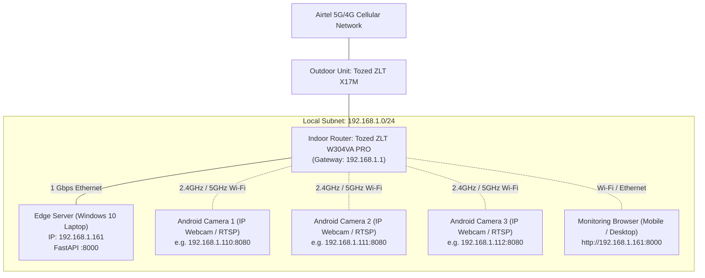

# Network Topology & Environment

## 1. Network Baseline

The initial deployment environment operates on a local residential network connected to fixed wireless access (FWA).

## 2. Infrastructure Inventory

| Node | Device Model | Connectivity | Role | IP / Port |
|---|---|---|---|---|
| Gateway / Router | Tozed ZLT W304VA PRO | Cellular / Ethernet / Wi-Fi | DHCP & Gateway | 192.168.1.1 |
| Cellular Antenna | Tozed ZLT X17M | ODU PoE / Ethernet | WAN Uplink | Managed by router |
| Edge Server | Windows 10 (Intel i5-1035G1, 8GB RAM) | 1 Gbps Ethernet | Monolith backend & web host | 192.168.1.161:8000 |
| Camera 1 | Android Device | 2.4/5 GHz Wi-Fi | RTSP Video Source | DHCP assigned |
| Camera 2 | Android Device | 2.4/5 GHz Wi-Fi | RTSP Video Source | DHCP assigned |
| Camera 3 | Android Device | 2.4/5 GHz Wi-Fi | RTSP Video Source | DHCP assigned |
| Dashboard Client | Mobile / PC Browser | LAN / WLAN | Browser Monitoring | Web client |

## 3. Traffic Flow & Protocol Mapping

1. **RTSP Stream Transport**:
   - `Android Phone -> Edge Server`: RTSP over TCP/UDP (`rtsp://<camera-ip>:<port>/h264_pcm.sdp` or standard RTSP endpoint).
2. **Local Edge Video Relay**:
   - `Edge Server -> Browser Client`: HTTP MJPEG multipart stream (`http://192.168.1.161:8000/api/v1/cameras/{id}/stream`).
3. **Control & Telemetry**:
   - `Browser Client -> Edge Server`: JSON REST API over HTTP (`http://192.168.1.161:8000/api/v1/...`).
4. **Remote Access (Phase 9)**:
   - WireGuard / Tailscale encrypted tunnel mapping remote clients into the virtual mesh network without direct port forwarding on cellular CGNAT.

