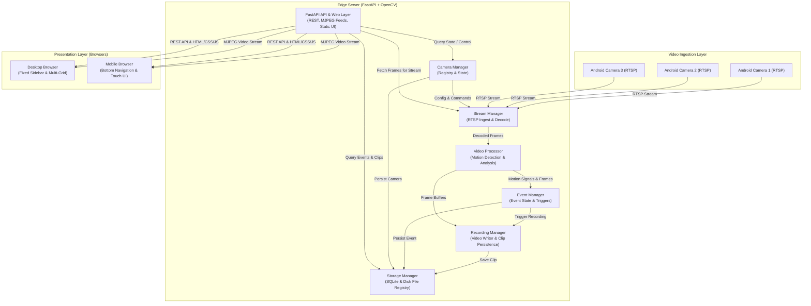

# System Architecture

## 1. Modular Monolith Architecture

The system is constructed as a modular monolith in Python using FastAPI. A single deployment unit avoids the operational complexity, network latency, and memory overhead of microservices while maintaining strict internal module separation.

## 2. Core Modules & Responsibilities

### Camera Manager (`src.edge_server.cameras`)
- Maintains camera configurations (ID, name, RTSP URL, credentials, status).
- Dispatches connection and disconnection commands to the Stream Manager.
- Monitors camera health and triggers auto-reconnection on stream loss.

### Stream Manager (`src.edge_server.streams`)
- Establishes and manages RTSP connections via OpenCV `cv2.VideoCapture` / FFmpeg.
- Runs thread-safe frame acquisition to prevent buffer lag (grabbing the freshest frame).
- Encodes frames into browser-compatible formats (MJPEG multipart response).
- Gracefully handles timeout, stream drop, and reconnection cycles.

### Video Processor (`src.edge_server.processing`)
- Controls processing frame rate (5–10 FPS) to conserve CPU cycles.
- Applies grayscale conversion, Gaussian blur, and frame differencing / background modeling.
- Detects contours and measures bounding box area against threshold limits.
- Annotates motion bounding boxes for visual verification when motion occurs.

### Event Manager (`src.edge_server.events`)
- Tracks active motion states per camera (idle vs active motion).
- Emits motion start and motion end events with precise timestamps.
- Manages post-motion cooldown periods before signalling recording completion.

### Recording Manager (`src.edge_server.recording`)
- Writes motion-triggered video clips to disk via `cv2.VideoWriter`.
- Continuously records during active motion and appends post-motion duration.
- Finalizes video container files cleanly and informs the Storage Manager.

### Storage Manager (`src.edge_server.storage`)
- Manages SQLite schema and transactions (cameras, events, recordings).
- Organizes disk directory structure: `data/recordings/{camera_id}/{YYYY-MM-DD}/`.
- Tracks disk space utilization and enforces retention policies.

### API & Presentation Layer (`src.edge_server.api`, `web/`)
- Exposes RESTful endpoints for cameras, streams, events, recordings, and system telemetry.
- Delivers MJPEG video streams: `GET /api/v1/cameras/{id}/stream`.
- Serves static assets (CSS, JS) and HTML application shell designed with the industrial-minimalist dark aesthetic.

